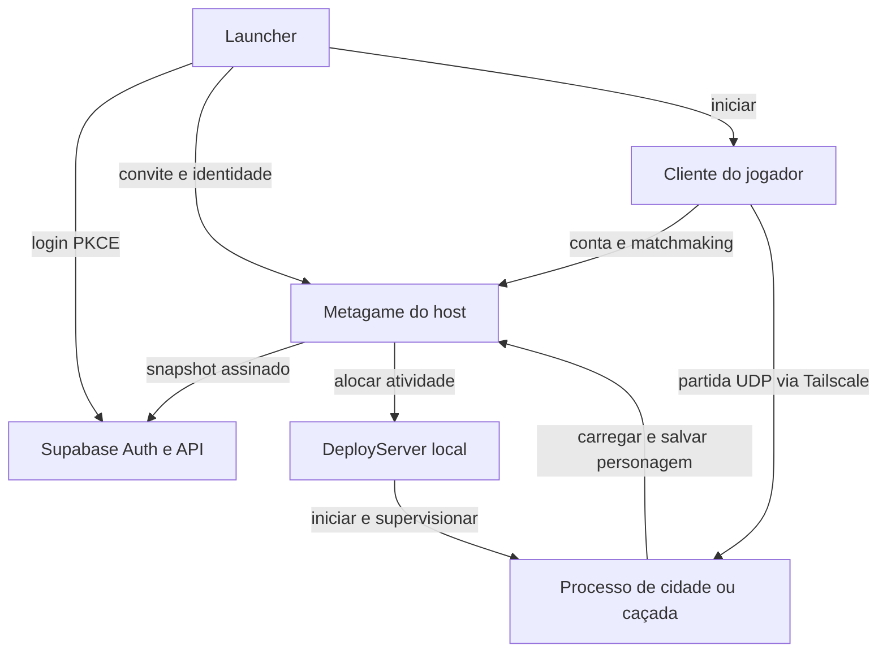

# Arquitetura e fluxo

## As cinco peças

| Peça | Responsabilidade | Onde ler o código |
|---|---|---|
| Launcher Electron | Interface, serviços locais, Tailscale, login e execução do cliente | `src/main.js`, `preload.js`, `renderer.js`, `index.html` |
| Metagame | Regras de backend, contas, personagens, inventário, chat e fila de atividades | `server/upstream/UndauntedMetagame/src` |
| DeployServer | Escolhe portas, inicia e supervisiona os executáveis que hospedam partidas | `server/upstream/UndauntedDeployServer/src` |
| Processo do jogo + DLL | Executa cliente ou cidade/caçada; a DLL adapta o cliente 1.4.4 | `server/upstream/UndauntedInternalServer` e executável externo |
| Supabase | Identidade Google e progresso pessoal canônico entre hosts autorizados | `supabase/`, `src/fenys-google-*.js` |

O launcher não simula monstros nem guarda a autoridade do save. O Metagame também não renderiza a partida: ela roda em outro processo do executável, iniciado pelo DeployServer. O mesmo executável 1.4.4 atua como cliente ou servidor com argumentos diferentes.

## Ao abrir o launcher

`main.js` executa no processo principal do Electron: lê configurações locais, abre a janela e controla processos. `preload.js` expõe uma interface limitada por IPC. `renderer.js` atualiza a interface; não recebe os tokens e chaves privadas como dados de tela. O renderer usa isolamento de contexto, sem acesso direto ao Node.

O launcher verifica as portas dos serviços e só controla os processos que ele iniciou. Selecionar uma pasta de servidor não a compila automaticamente; a preparação inicial vem antes. O botão Jogar confere os hashes do executável e das DLLs, prepara o chat e usa o runtime nativo no Windows ou Wine no Linux.

## Entrar com Google e recuperar o personagem

1. `fenys-google-auth.js` verifica o provedor e abre o navegador com PKCE. O retorno usa somente `127.0.0.1:43967`, com caminho aleatório e validade limitada.
2. O Supabase autentica o Google. O launcher troca o código, valida o usuário e guarda a sessão com proteção do sistema quando disponível; sem ela, usa apenas memória.
3. `fenys-google-player.js` coordena o perfil, vínculo e conexão. Um convite `DLU3` identifica o servidor e permite a primeira admissão.
4. A API do host valida a identidade por meio da API da nuvem. O host assina suas operações; a chave do jogador não substitui a autorização do host.
5. Um personagem antigo exige vínculo no servidor de origem, com a chave nativa original. Nome ou e-mail iguais não demonstram posse do personagem.
6. O host importa o progresso autorizado para seu SQLite e fornece a compatibilidade necessária ao cliente nativo. Para o jogador, a entrada continua sendo Google.

## Entrar em uma atividade

O cliente autentica no Metagame e recebe o token nativo. Ao escolher uma cidade, treino ou caçada, o Metagame resolve a fila e consulta o DeployServer em loopback. O DeployServer inicia ou reutiliza um processo e devolve IP/porta. O cliente se conecta por UDP; o processo de partida lê e salva dados no Metagame com a credencial própria de game server.

Há três credenciais distintas: conta do jogador, administração do host e processo de partida. A autorização Supabase inicial cadastra o host na nuvem e também não é uma chave para jogar.

## Salvar e trocar de servidor

No modo Google, cada host mantém seu próprio SQLite. A nuvem guarda o snapshot pessoal confirmado, com UID, personagens, XP, inventário e demais campos selecionados em `fenys-google-host.js`. Guildas, amizades e placares coletivos continuam locais ao host.

A API usa revisão do snapshot, assinatura Ed25519 e sessão exclusiva. Confirmações de save passam pela persistência remota; uma resposta perdida pode ser reenviada a partir da outbox local sem duplicar a operação. Em falha de sincronização, preserve o disco do host: a nuvem só recupera o que foi confirmado.

Antes da troca, feche o jogo. O launcher pede o save e a liberação da sessão anterior. Se o host caiu, o destino aguarda a expiração da sessão (75 segundos) e recupera o último snapshot confirmado. Não há transferência de uma caçada em andamento para outro processo.

## Modos antigos

`fenys-cloud-*` implementa a rede antiga com autoridade central; `fenys-direct-global.js`, `fenys-portable.js` e outros módulos preservam compatibilidade. O modo Google é ativado separadamente e não exige aquele PC central ligado. Não misture instruções dos modos nem apague bancos antigos antes de vincular e validar os personagens.
